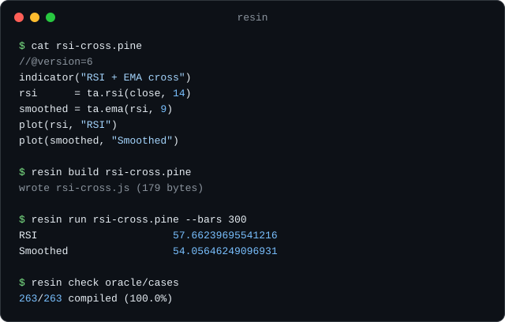

<p align="center">
  
</p>

<h1 align="center">Resin</h1>

<p align="center"><strong>TradingView の外で Pine Script を動かす。</strong></p>

<p align="center">
  <a href="https://github.com/nullarch/resin/actions/workflows/ci.yml"></a>
  
  
  <a href="LICENSE"></a>
</p>

<p align="center">
  <a href="#quick-start">クイックスタート</a> ·
  <a href="API.md">ライブラリ API</a> ·
  <a href="https://www.wavealgo.com/leaderboard">本番稼働例：wavealgo リーダーボード ↗</a>
</p>

<p align="center">
  <a href="README.md">English</a> ·
  <a href="README.zh-CN.md">简体中文</a> ·
  <strong>日本語</strong> ·
  <a href="README.ko.md">한국어</a>
</p>

<p align="center">
  
</p>

Resin は Pine Script v5/v6 を素の JavaScript モジュールにコンパイルして実行します。
同じインジケーター、同じ時系列セマンティクス、それがあなた自身のマシンで動きます。
TradingView はスクリプトをプラットフォームの外に出させてくれません。これはそれを外に出す方法です。

- **TradingView 自身のエクスポートと一致** — 95 シナリオ中 93: ストラテジー 20 シナリオすべて
  （取引と統計 16,259 件）と、インジケーターおよびライブラリ 75 シナリオ中 73。PyneCore `0fd57d7` を
  基準に測定。一致しなかった 2 件と、カバーしていない範囲も明記しています — [検証方法](#how-it-is-verified)
- 実在するスクリプト 2,979 本の **99.7%** がトランスパイルでき、**99.5%** が実行できる
  （[測定方法は下記](#coverage)）— 動くということであって、値が正しいということではありません
- **10,431 件のテスト**、加えて TradingView に対して認証された参照エンジンとバーごとに突き合わせる
  生成シナリオ 5,000 件
- **ランタイム依存ゼロ** — CLI は clone した状態からそのまま動く。インストール手順もビルド手順も不要
- **本番で稼働中** — [wavealgo リーダーボード](https://www.wavealgo.com/leaderboard)
  に並ぶスコアはすべてこのエンジンが計算しています

<a id="quick-start"></a>

## クイックスタート

Node 22.18 以上が必要です（TypeScript のソースを直接実行するため）。インストールするものはありません:

```bash
git clone https://github.com/nullarch/resin.git
cd resin

# インジケーターを実行し、最終バーの plot 値を表示する
node bin/resin.mjs run examples/rsi-cross.pine --bars 300
```

```text
RSI                      57.66239695541216
Smoothed                 54.05646249096931
```

```bash
# 読める形の JavaScript モジュールにコンパイルする
node bin/resin.mjs build examples/rsi-cross.pine -o rsi-cross.js

# 自分のスクリプトが入ったフォルダを指定し、どれだけコンパイルできるか調べる
node bin/resin.mjs check ./my-scripts

# チャートに必要なすべて — 色、シェイプ、描画オブジェクト — を JSON でダンプする
node bin/resin.mjs run examples/rsi-cross.pine --bars 300 --viz viz.json

# 任意: node bin/resin.mjs と打つ代わりに `resin` を PATH に通す
npm install -g @nullarch/resin
```

`run` は既定では決定論的なバーを合成します。`--data bars.json` を渡せば自分の OHLCV データを
使えます。clone しなくても同じ CLI が使えます: `npx @nullarch/resin build my.pine`。

## なぜ作ったか

Pine はトレードのアイデアを表現するには良い言語ですが、アイデアを置いておく場所としては良くありません。
Pine スクリプトを CI で走らせることはできず、午後いっぱいで千本バックテストすることもできず、
ボットに組み込むこともできず、週末をかけてチューニングしたインジケーターを自分のアプリケーションに
持ち込むこともできません。そのどれもが、スクリプトが別の場所で動くことを必要とします。

Resin はコンパイラとランタイムであって、チャート製品ではありません。値を渡すところまでが Resin の仕事で、
その値をどう使うかはあなたのものです。

## 本番環境: wavealgo リーダーボード

「TradingView の外で Pine を動かす」ことを最も分かりやすく示すのは、それを大規模にやっているサイトです。
[wavealgo.com/leaderboard](https://www.wavealgo.com/leaderboard) — 同じチームが作っています — は、
1 枚のチャートでは到底できないやり方で Pine ストラテジーを採点します。各スクリプトはこのエンジンで
コンパイルされ、**6 市場 × 3 時間軸、1 スクリプトあたり 18 セル**でバックテストされます。
約定は TradingView の「次バーの始値」ルールに従い、片道ごとの手数料も加味した上で、判定と
アルファスコアが与えられます。あのページの数字はすべてこのコンパイラから出たものです。
[方法論](https://www.wavealgo.com/methodology)は公開されています。

何かを clone する前に Resin の出力がどんなものか見たいなら、そこから始めてください。

<a id="coverage"></a>

## カバレッジと、その数字の出どころ

**0.3.0 を測定したコーパス:** 公開 GitHub リポジトリ 543 個から収集した Pine v5/v6 ファイル 3,904 本。

| | スクリプト数 | |
|---|---:|---|
| v5/v6 ファイル | 3,904 | |
| — ソースファイルではなく、スクレイピングされた Web ページ | −413 | 文章のヘッダー、"Expand" で途切れたコード |
| — 正当な Pine ではないもの | −313 | 人の手で判定。それぞれ、不正とされる根拠のマニュアルの一文つき |
| — コーパスに含まれない公開ライブラリを import しているもの | −199 | 別集計: うち 21 本がトランスパイル可能 |
| **通常のスクリプト** | **2,979** | |
| **トランスパイル成功** | **2,970** | **99.7%** |
| **合成した 1 時間足 1,500 本をエラーなく実行** | **2,964** | **99.5%** |

トランスパイルはできても実行できない 6 本は、すべて Pine のランタイムエラーで停止します。5 本は
自ら `runtime.error()` を呼んでおり — その多くは 60 分足のテストチャートを拒否するためのものです —
残る 1 本は `str.format` に、それが受け付けないパターンを渡しています。この数字が測っているのは実在の
スクリプトが通るかどうかであって、値が正しいかどうかではありません。値については
[次の節](#how-it-is-verified)で扱います。

**0.1 の調査 — 過去の測定として残しているもの。** 0.1.0 のときに測定し、以後は再実行していない数字で、
GitHub から収集した公開 Pine v5/v6 スクリプト **12,424** 本という、より大きなスナップショットに対するものです:

| | スクリプト数 | |
|---|---:|---|
| スナップショット | 12,424 | v5/v6、重複除去済み |
| — TradingView 自身も弾くもの | −1,085 | TradingView 純正のコンパイラで検証済み |
| — 解決できない非公開ライブラリを import しているもの | −719 | 対象外 |
| **母数** | **10,618** | |
| **コンパイル成功** | **10,100** | **95.1%** |

この 1,085 本の除外は私たちの判断ではありません。コンパイルに失敗したスクリプトはすべて
TradingView 純正のコンパイラに投げて結果を記録しており、これらは TradingView もまた受け付けない
ものです。本プロジェクトの以前のバージョンは検証ではなく推測でこの線引きをしており、
まったく正当なスクリプトを約 1,200 本も捨てかけました。

**どちらのコーパスもこのリポジトリには含まれていません。** どちらもライセンスがまちまちで、多くの場合は
明示すらされていない、数千本のサードパーティ製スクリプトであり、それを再配布するのは私たちの権利では
ありません。したがってこれらの具体的な数字をここで再現することはできません。再現できるのは方法だけです。
すでにお手元にあるスクリプトに対して `resin check` を走らせてください。

リポジトリにある `corpus/` ディレクトリは、そのどちらとも別物です。Resin が最初に突き合わせの相手とした
姉妹実装のテストスイートから取った Pine のフィクスチャで、回帰チェックとして、その実装のゴールデン出力と
突き合わせています（後述）。ソースコメントが挙げている `corpus/wild/...` は 0.1 の調査を指しており、
それらのパスはここでは解決しません。

<a id="how-it-is-verified"></a>

## どう検証しているか

自分自身と整合しているだけのコンパイラは何も証明しません。このプロジェクトはそれを痛い目にあって
学びました（[後述](#how-this-was-built)）。0.3.0 からは、別個のハーネスが Resin を正解データに照らして
測定しています。権威の順序は次のとおりです:

1. **TradingView 自身の結果。** PyneSys が TradingView のエクスポートを記録し、PyneCore のリポジトリ
   （Apache-2.0）で公開しています。測定の基準は PyneCore のコミット `0fd57d7`（2026-11-09）です。
   PyneCore 自身のスクリプトは Python なので、各シナリオの Pine はそれらから私たちが再構成したもので、
   PyneSys の Pine ではありません。そこにある 97 シナリオのうち、95 は TradingView のエクスポート、
   2 は手作りのフィクスチャ（`sess_002`、`draw_001`）です。Resin は 97 件中 95 件を、エクスポート
   95 件中 93 件を、完全に再現します:
   - **ストラテジー、20 シナリオ。** List of Trades エクスポート 14 件 — TradingView 組み込みの
     ストラテジーと、手数料・スリッページ・ピラミッディング・先物のポイントバリュー・バーマグニファイア、
     そして段階的に進める `calc_on_order_fills` を使った実行（決済済みの取引 15,139 件。1 件ごとに
     売買の向き、エントリーとエグジットのバー、半ティック以内の価格、相対誤差 1e-6 以内の数量が一致し、
     余分な取引はありません）— に加えて、プロットされた `strategy.*` の値を記録したチャート
     エクスポート 3 件から得た 6 シナリオ（1,120 バー。プロットされたすべての値が一致）。
   - **インジケーターとライブラリ、77 シナリオ**（`ta.*`、`math.*`、`str.*`、`timeframe.*`、
     `session.*`、`request.security`、`map.*`、`array.*`、`matrix.*`、`time`/`timestamp`、
     `chart.point`）: チャートエクスポートと Pine Logs の出力。系列は 1e-6 で一致とみなします
     （PyneCore 自身の許容誤差は相対 1e-5、絶対 1e-8 とより緩く、どの判定も変わりません）。`na` が
     一致する相手は `na` だけで、ログ行は前後の空白を除いたうえで完全一致が条件です。75 件が
     一致し、一致しない 2 件は `array.slice` です（下記）。
   - **一致しないもの。** `array_002` と `array_003`: TradingView の `array.slice` は元の配列に書き
     込みが反映されるビューですが、Resin のものはコピーなので、その書き込みに依存する行はすべて
     食い違います。
   - **まだユーザーが使える機能ではありません。** ログ行の結果は `onLog` オプションで取得して
     います。このオプションができる前は、ハーネスが内部関数を差し替えないとログ行を見られませんでした。
   - **まだ公開していません。** これらの数字を出したハーネス — ケースのマニフェスト、Pine
     ファイル、数え方のルール — は、このリポジトリにはありません。公開されるまでは、同じ方法を
     自分で繰り返す以外に、数字を確かめる手段はありません。
   0.2.2 が一致していたのは、当時存在した 19 のストラテジーシナリオのうち 2 つだけでした。
2. **TradingView に対して認証された参照エンジンと、それを相手にしたファジング。** PyneSys の報告では、
   PyneCore は公開されているストラテジー 402 本中 380 本で TradingView と取引単位で一致し、
   61.8M 本のバーの 99.64% でビット単位で一致します（これは PyneSys 側の数字で、ここでは再測定して
   いません。PyneCore のテストスイートには上のシナリオが含まれています）。ハーネスは
   生成したシナリオを 2 回書き出します — Resin 用の Pine と、PyneCore 用の Python として — そして
   すべての取引とすべてのバーを 1e-9 で突き合わせます。生成シナリオ 5,000 件中 4,937 件が一致します:
   ストラテジー 3,600 件すべて、言語 600 件すべて（var/varip、関数の呼び出し箇所、ヒストリー、
   遅延評価、除算、UDT）、インジケーター 800 件中 737 件。手書きのプローブは 118 件中 117 件が通ります。
3. **Pine のマニュアル。** 前の二つが何も言っていない箇所と、参照エンジンがマニュアルの明示的な一文と
   食い違い、かつ TradingView の実測でも決着がつかない箇所で用います。そうした食い違いは文書にまとめ、
   人間が裁定します。ループが決めることはありません。
4. **実在スクリプトのコーパス**（[前述](#coverage)）: スクリプトがトランスパイルでき、実行できるか。
   受け入れ可否だけを見ます。

0.3.0 で変わったルールは、すべてこうして見つけられ、直されました。1 コミットにつき 1 ルールで、
根拠はコミットメッセージにあります。[CHANGELOG.md](CHANGELOG.md) にその一覧と、まだ残っている
食い違いが載っています。

Resin 自身のテストスイート（10,431 件）はそれらのルールを固定するものであって、それ単体では証拠に
なりません。以前の差分スイートもリポジトリに残っています: `oracle/` の 263 ケースと `corpus/` の
3,000 スクリプトのリプレイを、姉妹実装のゴールデン出力と 1e-9 で突き合わせるものです。TradingView の
証拠がゴールデンと食い違った箇所では、ゴールデンを修正するか不一致を記録し、その根拠を明記しました。
このスイートは今では回帰を防ぐ役割しか担っていません。

検証されて**いない**もの:

- 任意の実在スクリプトの値 — コーパスが確認するのは動くかどうかだけです。その数字は、上のシナリオと
  共有しているルールの分だけ検証されているにすぎません。
- 描画オブジェクト（`label`、`line`、`box`、`table`）と、その他の `viz` キャプチャ。
- ビューとしての `array.slice`: Resin はコピーを返すため、スライスへの書き込みは元の配列に届きません。
- 上の 97 シナリオの外にあるものすべて。タイムゾーン付きの `time`/`timestamp` や UTC 以外の取引所も
  含みます — それをカバーするエクスポートはありません。
- v5 だけのルール — 定数同士の整数除算、厳格な `and`/`or`、na のブール値、v5 のオーバーロードと
  デフォルト値 — は、マニュアル以外とは照合されていません。参照エンジンが v6 を実装しているためです。

## 実装済みの範囲

Pine のセマンティクスは独特で、作業量の大半は構文ではなくそちらにあります。あらゆる値が時系列であり、
`var` と `varip` はそれぞれ固有の初期化規則を持ち、`na` はすべての文脈で `NaN` と同じではなく、
テクニカル分析関数は呼び出し箇所ごとの隠れた状態を持っていてコンパイル時に確保する必要があり、
条件分岐の中の `ta.*` 呼び出しは、その分岐が実行されなかったバーでも状態を進めなければなりません。
実装され、テストされているのはこの部分です。

68 個の `ta.*` 関数 — TradingView の `na` の扱い、そしてその多くはバーごとに変わる長さにも対応;
ストラテジーエンジン — エントリー、エグジットとブラケット、ピラミッディング、OCA グループ、手数料、
スリッページ、マージンコール、`process_orders_on_close`、`calc_on_order_fills`、バーマグニファイア、
`strategy.*` の統計; ユーザー定義型とメソッド、配列、マップ、行列; チャートのシンボル、または
あなたが渡したフィードに対する `request.security` — ネストしたリクエストと、リクエスト先の
コンテキストで評価される式を含む; シンボルの取引所カレンダー上で計算される `timeframe.*` と
`session.*`; 描画オブジェクト; そして `input.*` 一式。

## ライブラリとして使う

```js
import { transpile, compile, Context } from '@nullarch/resin';

const result = transpile(source, { chartTf: 'D' });
if (!result.ok) throw new Error(result.errors.join('\n'));

const ctx = Context.from(result, data);
const bar = compile(result.code)(ctx);
for (let i = 0; i < ctx.barCount; i++) { ctx.advance(); bar(); }

console.log(ctx.plots[0].toArray());
```

実行の途中経過を観測する必要がなければ、`run(result, data)` が同じことを 1 回の呼び出しで行い、
その戻り値には `viz` が載っています — plot のスタイルとバーごとの色、マーカーの条件、
背景/バー色のストライプ、fill、そしてスクリプトが作ったすべての label/line/box/table まで。
サポート対象の API 面は `src/index.ts` が export しているものが厳密にすべてです。
それ以外の `src/` 配下は内部実装であり、変更されます。[API.md](API.md) を参照してください。

ストラテジーの数字は、それが動くシンボルによって変わります。シンボルのティックとロットの刻み、ポイント
バリュー、取引所カレンダーを `transpile(source, { chartTf, syminfo })` で渡してください — デフォルトは
ティック 0.01、ロット 1、ポイントバリュー 1、UTC、24 時間開いている市場です。他のシンボルのバー
（`request.security` 用）や下位時間軸のバー（`use_bar_magnifier` 用）は
`run(result, data, { security, magnifier })` で、あるいは同じオプションを `Context.from` に渡します。

パッケージは TypeScript ソースをそのまま配布しています。バンドラー（Next.js、Vite、webpack）は
そのまま消費できます。素の Node では同梱のローダーフックを付けて実行してください:

```sh
node --import @nullarch/resin/register your-script.mjs
```

## やらないこと

- **チャートはありません。** Resin は plot の系列を計算します。それを描くのはあなたの仕事です。
- **ここではチャートはピクセルではなくデータです。** 0.2.0 から可視化呼び出しは捨てられる
  代わりにキャプチャされます: plot のスタイルとバーごとの色、`plotshape` / `plotchar` /
  `plotarrow` / `plotcandle` / `plotbar`、`bgcolor` / `barcolor` / `hline` / `fill`、
  そしてすべての `label` / `line` / `box` / `table` の生成が `run(result, data).viz` —
  CLI では `resin run --viz out.json` — で返ってきます。
  [resin-lightweight-charts](https://github.com/nullarch/resin-lightweight-charts) が
  このデータを TradingView 自身のオープンソースチャート上に描画します。`polyline`、
  `linefill`、`alert`、`alertcondition` は no-op のままです。
- **ストラテジーの結果は、上のシナリオについては TradingView と突き合わせて確認済みですが、すべての
  スクリプトについてではありません。** ブローカーエミュレーターは、エクスポートされた 14 シナリオで
  TradingView の List of Trades を、生成された 3,600 シナリオで認証済みのエンジンを再現します。
  そのどれも試していない組み合わせで機能を使うスクリプトは、まだ測定されていないルールに出くわす
  可能性があります。
- **バー内の約定は市場の実際の経路ではなく、TradingView の仮定です。** 逆指値・指値・トレーリングでの
  決済がバーの内側のどこで起きたのか、OHLC は記録していません。Resin は TradingView と同じ仮定を
  置きます — 始値、次に近いほうの極値、遠いほうの極値、終値 — あるいは `use_bar_magnifier` が有効なら、
  あなたが渡した下位時間軸のバーをたどります。それで TradingView のバックテストが再現されますが、
  そのバックテスト自体が推定です。
- **リアルタイムはありません。** Resin は閉じたデータセットを実行します。最後のバーも含めてすべての
  バーはヒストリカルで、ティックごとに再計算されるものはありません。
- **シンボルの属性はあなたが渡す必要があります。** ティックサイズ、ロットサイズ、ポイントバリュー、
  タイムゾーン、セッションの時間割は結果を変えますが、Resin はそれらを調べることができません:
  `syminfo` で渡してください。`hour` や `dayofweek` などの時間系の組み込み関数は、タイムゾーンに
  関係なくいまも UTC を読みます。タイムゾーンに従うのは `str.format_time`、`timeframe.change`、
  `session.*` だけです。
- **`request.security` はあなたが渡したバーを読みます**、取得するのではありません。チャート自身の
  シンボルなら Resin がチャートのバーから上位時間軸を組み立て、他のシンボルは `opts.security` で渡した
  フィードを、なければチャートのバーを読みます。チャートのバーから組み立てた上位時間軸の値は、現状、
  参照エンジンとマニュアルより 1 チャートバー遅れて届きます — 既知の欠落です。`opts.security` で
  フィードを渡したリクエストは正しく対応づけられます。
- **`v4` 以前には対応しません。** v5 が下限です。
- **一部のセマンティクスは、いまも実測ではなく推論です。** TradingView のエクスポートも参照エンジンも
  何も言っていない箇所では、Resin はマニュアルに従います。マニュアルすら沈黙している箇所では、その
  推論と根拠が呼び出し箇所のコメントに置かれ、実測ではなく仮説として明示されています。
- **既知の欠落は、それが実際に問題になる場所に記録されています。** ロングテールにあるのは、バーごとに
  変わる `ta.ema`・`ta.rsi` の長さや、配列フィールドを持つオブジェクトを返す `request.security`
  などです。それぞれ拒否される箇所にコメントがあり、回避策がある場合には併記されています。

<a id="how-this-was-built"></a>

## どうやって作られたか

Resin は自律エージェントのループによって、800 回あまりのイテレーションを重ねて開発されました。
各イテレーションは、固定された状態ファイル群に対する 1 コミットです。そのループは自分の仕事を同じ言語の
姉妹実装と突き合わせており、結局その実装の誤りへと収束していきました: ストラテジーエンジンが手数料、
スリッページ、`process_orders_on_close` を無視し、`ta.rsi` が 1 バー早く始まり、`ta.supertrend` が
逆を向いていたあいだも、9,883 件のテストはすべて緑でした。

0.3.0 は、自分の宿題を自分で採点しない二つ目のループの成果です。上で説明したハーネスが Resin を
TradingView の結果と認証済みの参照エンジンに照らして測定し、食い違いに順位をつけ、それぞれを最小の
再現例に縮めます。1 回のイテレーションが直すのは 1 つのルールで、どの数字も下がることを許さない
ラチェットの内側で行われます。121 のコミットそれぞれが、ルールを述べ、根拠を引用し、何が動いたかを
記しています。

一つ目のループの帰結が一つ、ソースの中に見える形で残っています。読み始める前に知っておいてください:

- **コンパイラとランタイムのエラーメッセージはすべて英語です** — 韓国語で始まった 365 件が、
  このリストの何よりも先に翻訳されました。ツールを*読む*ことではなく*使う*ことに影響する
  唯一の項目だったからです。3,000 スクリプトの差分リプレイを含む全テストスイートが、この変更による
  挙動の変化がゼロであることを固定しています。
- **`src/` の行のおよそ四分の一が韓国語のコメントです**、およそ 12,400 行。読み飛ばすという選択肢は
  現実的ではありません — 奇妙に見える分岐の背後にある論拠の多くがそこに書かれているからです —
  そのため、削除するのではなく翻訳を進めています。0.2.2 以降に追加されたコメントは、既存の韓国語
  コメントの修正を除けば英語です。
- コード、識別子、README、API ドキュメントはすべて英語です。

## PineTS についての告知

[PineTS](https://github.com/alaa-eddine/PineTS) は既存の AGPL-3.0 の Pine→JavaScript プロジェクトです。
Resin はそれとコードを共有していません。文書化されていない TradingView のセマンティクス —
`dayofweek` の値、どの plot スタイルが存在するか、といった類のもの — についてのブラックボックスな
挙動の参照先として参照しており、それを行った箇所はすべてソースコードのコメントで出典を明記しています。
来歴が主張ではなく監査可能であるようにするためです。サードパーティ製品についての事実に著作権は
及びません。その実装がこちらに読み込まれたことはありません。

## ライセンス

Apache-2.0。[LICENSE](LICENSE) を参照してください。

Pine Script および TradingView は TradingView, Inc. の商標です。本プロジェクトは TradingView と
提携関係にはなく、その承認を受けたものでもありません。
