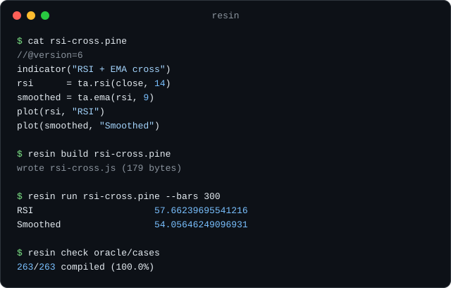

<p align="center">
  
</p>

<h1 align="center">Resin</h1>

<p align="center"><strong>TradingView 밖에서 Pine Script를 실행하세요.</strong></p>

<p align="center">
  <a href="https://github.com/nullarch/resin/actions/workflows/ci.yml"></a>
  
  
  <a href="LICENSE"></a>
</p>

<p align="center">
  <a href="#quick-start">빠른 시작</a> ·
  <a href="API.md">라이브러리 API</a> ·
  <a href="https://www.wavealgo.com/leaderboard">실제 운영 사례: wavealgo 리더보드 ↗</a>
</p>

<p align="center">
  <a href="README.md">English</a> ·
  <a href="README.zh-CN.md">简体中文</a> ·
  <a href="README.ja.md">日本語</a> ·
  <strong>한국어</strong>
</p>

<p align="center">
  
</p>

Resin은 Pine Script v5/v6를 평범한 JavaScript 모듈로 컴파일해서 실행합니다. 같은 지표,
같은 시계열 시맨틱스를 당신의 기계에서 돌립니다. TradingView는 스크립트가 플랫폼 밖으로
나가는 것을 허용하지 않습니다. 이건 그걸 꺼내오는 방법입니다.

- **TradingView 자체 내보내기와 일치** — 95개 시나리오 중 93개: 전략 시나리오 20개 전부
  (거래와 통계 16,259건)와 지표·라이브러리 시나리오 75개 중 73개. PyneCore `0fd57d7`을 기준으로
  측정했습니다. 일치하지 않은 2개와 다루지 않는 범위도 함께 밝혀 둡니다 — [검증 방법](#how-it-is-verified)
- 실제 스크립트 2,979개 중 **99.7%** 트랜스파일, **99.5%** 실행 ([측정 방법은 아래](#coverage))
  — 실행된다는 뜻이지, 값이 맞다는 뜻은 아닙니다
- **테스트 10,431개**, 그리고 TradingView와 대조해 인증된 참조 엔진과 바 단위로 비교하는
  생성 시나리오 5,000개
- **런타임 의존성 0** — CLI는 clone한 그대로 실행됩니다. 설치 단계도, 빌드 단계도 없습니다
- **프로덕션에서 가동 중** — [wavealgo 리더보드](https://www.wavealgo.com/leaderboard)의
  모든 점수가 이 엔진으로 계산됩니다

<a id="quick-start"></a>

## 빠른 시작

Node 22.18 이상이 필요합니다 (TypeScript 소스를 직접 실행합니다). 설치할 것은 없습니다:

```bash
git clone https://github.com/nullarch/resin.git
cd resin

# 지표를 실행하고 마지막 바의 plot 값을 출력
node bin/resin.mjs run examples/rsi-cross.pine --bars 300
```

```text
RSI                      57.66239695541216
Smoothed                 54.05646249096931
```

```bash
# 읽을 수 있는 JavaScript 모듈로 컴파일
node bin/resin.mjs build examples/rsi-cross.pine -o rsi-cross.js

# 자기 스크립트 폴더를 지정해서 그중 얼마나 컴파일되는지 확인
node bin/resin.mjs check ./my-scripts

# 차트에 필요한 모든 것 — 색, 도형, 드로잉 — 을 JSON으로 덤프
node bin/resin.mjs run examples/rsi-cross.pine --bars 300 --viz viz.json

# 선택: node bin/resin.mjs 대신 `resin` 명령을 PATH에 등록
npm install -g @nullarch/resin
```

`run`은 기본적으로 결정론적인 바를 합성합니다. `--data bars.json`을 넘기면 자신의 OHLCV
데이터를 쓸 수 있습니다. clone 없이도 같은 CLI를 쓸 수 있습니다: `npx @nullarch/resin build my.pine`.

## 왜 만들었나

Pine은 매매 아이디어를 표현하기에는 좋은 언어지만, 아이디어를 보관하기에는 나쁜 장소입니다.
Pine 스크립트는 CI에서 돌릴 수 없고, 하루 오후에 천 개를 백테스트할 수 없고, 봇에 임베드할 수
없고, 주말 내내 튜닝한 지표를 자기 애플리케이션에 넣을 수도 없습니다. 그 모든 일이 스크립트가
다른 곳에서 실행되기를 요구합니다.

Resin은 컴파일러이자 런타임이지 차팅 제품이 아닙니다. 값을 줄 뿐이고, 그 값으로 무엇을 할지는
당신의 몫입니다.

## 프로덕션: wavealgo 리더보드

"Pine을 TradingView 밖에서 돌린다"를 가장 분명하게 보여주는 것은, 그걸 대규모로 하고 있는
사이트입니다. [wavealgo.com/leaderboard](https://www.wavealgo.com/leaderboard) — 같은 팀이
만들었습니다 — 는 차트 한 장으로는 결코 할 수 없는 방식으로 Pine 전략을 채점합니다. 각
스크립트는 이 엔진으로 컴파일되어 **6개 시장 × 3개 타임프레임, 스크립트당 18개 셀**에서
백테스트되며, TradingView의 다음 바 시가 체결 규칙과 편도 수수료를 적용한 뒤 판정과 알파
점수를 받습니다. 그 페이지의 모든 숫자가 이 컴파일러에서 나왔고,
[방법론](https://www.wavealgo.com/methodology)은 공개되어 있습니다.

아무것도 clone하기 전에 Resin의 출력이 어떤 모양인지 보고 싶다면 거기서 시작하세요.

<a id="coverage"></a>

## 커버리지, 그리고 그 숫자들의 출처

**0.3.0을 측정한 코퍼스:** 공개 GitHub 저장소 543곳에서 수집한 Pine v5/v6 파일 3,904개.

| | 스크립트 | |
|---|---:|---|
| v5/v6 파일 | 3,904 | |
| — 소스 파일이 아닌, 스크랩된 웹 페이지 | −413 | 산문 머리말, "Expand"에서 잘린 코드 |
| — 유효한 Pine이 아닌 것 | −313 | 사람이 판정, 각각 무효의 근거가 되는 매뉴얼 문장과 함께 |
| — 코퍼스에 없는 공개 라이브러리를 import | −199 | 따로 집계: 그중 21개가 트랜스파일됨 |
| **일반 스크립트** | **2,979** | |
| **트랜스파일 성공** | **2,970** | **99.7%** |
| **합성 1시간봉 1,500개를 에러 없이 실행** | **2,964** | **99.5%** |

트랜스파일은 되지만 실행되지 않는 6개는 모두 Pine 런타임 에러로 멈춥니다. 5개는 스스로
`runtime.error()`를 호출하고 — 대부분 60분봉 테스트 차트를 거부하는 것입니다 — 나머지 1개는
`str.format`에 그것이 거부하는 패턴을 넘깁니다. 이 수치는 실제 스크립트가 통과하는지를 잴 뿐,
그 값이 맞는지는 재지 않습니다. 값은 [다음 섹션](#how-it-is-verified)의 주제입니다.

**0.1 조사 — 역사적 측정으로 남겨둔 것.** 0.1.0 때 측정한 뒤 다시 돌리지 않은 수치로, GitHub에서
수집한 공개 Pine v5/v6 스크립트 **12,424개**라는 더 큰 스냅샷에 대한 것입니다:

| | 스크립트 | |
|---|---:|---|
| 스냅샷 | 12,424 | v5/v6, 중복 제거 |
| — TradingView도 거부하는 것 | −1,085 | TradingView 자체 컴파일러로 검증 |
| — 해석할 수 없는 비공개 라이브러리를 import | −719 | 범위 밖 |
| **분모** | **10,618** | |
| **컴파일 성공** | **10,100** | **95.1%** |

이 1,085개 제외는 우리의 판단이 아닙니다. 실패한 스크립트는 전부 TradingView 자체 컴파일러에
제출해 결과를 기록했고, 이것들은 TradingView 역시 거부하는 것들입니다. 이 프로젝트의 이전
버전은 검증 대신 추론으로 그 선을 그었고, 멀쩡한 스크립트 약 1,200개를 버릴 뻔했습니다.

**두 코퍼스 모두 이 저장소에 없습니다.** 둘 다 라이선스가 뒤섞여 있고 대개는 아예 없는 서드파티
스크립트 수천 개이며, 그것을 재배포하는 것은 우리 권한이 아닙니다. 그래서 그 특정 숫자들을
여기서 재현할 수는 없습니다 — 재현할 수 있는 것은 방법뿐입니다. 이미 가지고 있는 스크립트에
`resin check`를 돌려보세요.

저장소에 있는 `corpus/` 디렉토리는 또 다른 것입니다. Resin이 처음에 대조 기준으로 삼았던 자매
구현의 테스트 스위트에서 가져온 Pine 픽스처이고, 회귀 검사로서 그 구현의 골든 출력과 다시
대조됩니다(아래). 소스 주석이 인용하는 `corpus/wild/...`는 0.1 조사를 가리키며, 그 경로들은
여기서 해석되지 않습니다.

<a id="how-it-is-verified"></a>

## 어떻게 검증하는가

자기 자신과만 일치하는 컴파일러는 아무것도 증명하지 못합니다. 이 프로젝트는 그것을 어렵게
배웠습니다([아래](#how-this-was-built)). 0.3.0부터는 별도의 하네스가 Resin을 정답에 대해 측정하며,
권위의 순서는 다음과 같습니다:

1. **TradingView 자체의 결과.** PyneSys가 TradingView 내보내기를 기록해 PyneCore 저장소
   (Apache-2.0)에 공개했습니다. 우리는 PyneCore 커밋 `0fd57d7`(2026-11-09)을 기준으로 측정합니다.
   PyneCore 자체의 스크립트는 Python이므로, 시나리오마다의 Pine은 그것들로부터 우리가 재구성한
   것이며 PyneSys의 Pine이 아닙니다. 거기에 있는 97개 시나리오 중 95개는 TradingView 내보내기이고
   2개는 손으로 만든 픽스처(`sess_002`, `draw_001`)입니다. Resin은 97개 중 95개를, 내보내기
   95개 중 93개를 완전히 재현합니다:
   - **전략, 시나리오 20개.** List of Trades 내보내기 14개 — TradingView 내장 전략들, 그리고
     수수료·슬리피지·피라미딩·선물 포인트 가치·바 돋보기(bar magnifier), 단계적으로 진행하는
     `calc_on_order_fills`를 쓴 실행들(청산된 거래 15,139건. 거래마다 방향, 진입·청산 바, 반 틱 이내의
     가격, 상대 오차 1e-6 이내의 수량이 일치하며 불필요한 거래는 없음) — 그리고 그려진 `strategy.*`
     값을 기록한 차트 내보내기 3개에서 나온 시나리오 6개(바 1,120개, 그려진 모든 값이 일치).
   - **지표와 라이브러리, 시나리오 77개**(`ta.*`, `math.*`, `str.*`, `timeframe.*`, `session.*`,
     `request.security`, `map.*`, `array.*`, `matrix.*`, `time`/`timestamp`, `chart.point`):
     차트 내보내기와 Pine Logs 출력. 시리즈는 1e-6에서 일치로 봅니다(PyneCore 자체의 허용 오차는
     상대 1e-5, 절대 1e-8로 더 느슨하며 어느 판정도 바꾸지 않습니다). `na`는 `na`하고만 일치하고,
     로그 줄은 앞뒤 공백을 제거한 뒤 정확히 일치해야 합니다. 75개가 일치하며, 일치하지 않는
     2개는 `array.slice`입니다(아래).
   - **일치하지 않는 것.** `array_002`와 `array_003`: TradingView의 `array.slice`는 원본 배열에
     쓰기가 반영되는 뷰이지만 Resin의 것은 복사본이라, 그 쓰기에 의존하는 모든 줄이 다릅니다.
   - **아직 사용자가 쓸 수 있는 기능이 아닙니다.** 로그 줄 결과는 `onLog` 옵션으로 가져옵니다.
     이 옵션이 생기기 전에는 하네스가 내부 함수를 바꿔치기해야 로그 줄을 볼 수 있었습니다.
   - **아직 공개하지 않았습니다.** 이 수치를 만든 하네스 — 케이스 매니페스트, Pine 파일, 집계
     규칙 — 는 이 저장소에 없습니다. 공개되기 전까지는 같은 방법을 직접 반복하는 것 말고는
     수치를 확인할 방법이 없습니다.
   0.2.2는 당시 존재하던 전략 시나리오 19개 중 2개만 일치했습니다.
2. **TradingView와 대조해 인증된 참조 엔진, 그리고 그것을 상대로 한 퍼징.** PyneSys의 보고에 따르면
   PyneCore는 공개된 전략 402개 중 380개에서 TradingView와 거래 단위로 일치하고, 61.8M개 바의
   99.64%에서 비트 단위로 일치합니다(이는 PyneSys 측 수치로 여기서 다시 측정하지 않았으며,
   PyneCore의 테스트 스위트에 위의 시나리오가 들어 있습니다). 하네스는 생성한 시나리오
   하나를 두 번 씁니다 — Resin용 Pine과 PyneCore용 Python으로 — 그리고 모든 거래와 모든 바를
   1e-9로 비교합니다. 생성 시나리오 5,000개 중 4,937개가 일치합니다: 전략 시나리오 3,600개 전부,
   언어 시나리오 600개 전부(var/varip, 함수 호출 지점, 히스토리, 지연 평가, 나눗셈, UDT), 지표
   시나리오 800개 중 737개. 손으로 쓴 프로브는 118개 중 117개가 통과합니다.
3. **Pine 매뉴얼.** 앞의 둘이 아무 말도 하지 않는 곳, 그리고 참조 엔진이 매뉴얼의 명시적인 문장과
   어긋나는데 TradingView 실측이 판가름해주지 않는 곳에서 씁니다. 그런 불일치는 문서로 정리되어
   사람이 판정하며, 루프가 결정하는 일은 없습니다.
4. **실제 스크립트 코퍼스** ([위](#coverage)): 스크립트가 트랜스파일되고 실행되는가.
   수용성만 봅니다.

0.3.0에서 바뀐 모든 규칙은 이렇게 발견되고 고쳐졌습니다. 커밋 하나에 규칙 하나, 근거는 커밋
메시지에 있습니다. [CHANGELOG.md](CHANGELOG.md)에 그 목록과, 아직 열려 있는 불일치가 있습니다.

Resin 자체의 테스트 스위트(10,431개)는 그 규칙들을 고정해 둘 뿐, 그 자체로는 증거가 아닙니다.
예전의 차분 스위트도 저장소에 남아 있습니다: `oracle/`의 263개 케이스와 `corpus/`의 3,000개
스크립트 리플레이를 자매 구현의 골든 출력과 1e-9로 비교합니다. TradingView의 증거가 골든과
어긋난 곳에서는 골든을 고치거나 불일치를 기록했고, 그 근거를 인용해 두었습니다. 이 스위트는
이제 회귀를 막는 역할만 합니다.

검증되지 **않은** 것:

- 임의의 실제 스크립트의 값 — 코퍼스는 실행 여부만 확인합니다. 그 숫자는 위 시나리오들과
  공유하는 규칙만큼만 검증된 것입니다.
- 드로잉(`label`, `line`, `box`, `table`)과 나머지 `viz` 캡처.
- 뷰로서의 `array.slice`: Resin은 복사본을 반환하므로 슬라이스에 쓴 값이 원본 배열에 닿지 않습니다.
- 위의 97개 시나리오 밖의 모든 것. 시간대가 있는 `time`/`timestamp`와 UTC가 아닌 거래소도
  포함합니다 — 이를 다루는 내보내기가 없습니다.
- v5 전용 규칙 — 상수끼리의 정수 나눗셈, 엄격한 `and`/`or`, na 불리언, v5 오버로드와 기본값 —
  은 매뉴얼 말고는 대조할 대상이 없습니다. 참조 엔진이 v6를 구현하기 때문입니다.

## 구현된 범위

Pine의 시맨틱스는 독특하고, 작업량의 대부분은 문법이 아니라 거기에 있습니다. 모든 값이
시계열이고, `var`와 `varip`는 각자의 초기화 규칙을 가지며, `na`는 모든 문맥에서 `NaN`인 것이
아니고, 기술적 분석 함수는 컴파일 타임에 할당해야 하는 호출별 숨은 상태를 지니며, 조건부로
실행되는 `ta.*` 호출은 그 분기가 실행되지 않은 바에서도 상태를 전진시켜야 합니다. 구현되고
테스트된 부분이 바로 이것들입니다.

`ta.*` 함수 68개 — TradingView의 `na` 처리, 그리고 대부분은 바마다 바뀌는 길이까지; 전략
엔진 — 진입, 청산과 브래킷, 피라미딩, OCA 그룹, 수수료, 슬리피지, 마진콜,
`process_orders_on_close`, `calc_on_order_fills`, 바 돋보기, `strategy.*` 통계; 사용자 정의
타입과 메서드, 배열, 맵, 행렬; 차트 심볼 또는 당신이 제공한 피드에 대한 `request.security` —
중첩 요청과 요청된 컨텍스트에서 평가되는 표현식 포함; 심볼의 거래소 캘린더 위에서 계산되는
`timeframe.*`와 `session.*`; 드로잉 객체; 그리고 `input.*` 계열.

## 라이브러리로 사용하기

```js
import { transpile, compile, Context } from '@nullarch/resin';

const result = transpile(source, { chartTf: 'D' });
if (!result.ok) throw new Error(result.errors.join('\n'));

const ctx = Context.from(result, data);
const bar = compile(result.code)(ctx);
for (let i = 0; i < ctx.barCount; i++) { ctx.advance(); bar(); }

console.log(ctx.plots[0].toArray());
```

실행 도중의 상태를 관찰할 필요가 없다면 `run(result, data)`가 같은 일을 한 번의 호출로
처리하고, 그 반환값에는 `viz`가 실려 있습니다 — plot 스타일과 바별 색, 마커 조건,
배경/바 색 줄무늬, fill, 그리고 스크립트가 만든 모든 label/line/box/table까지. 지원되는
표면은 정확히 `src/index.ts`가 export하는 것뿐이며, 그 밖의 `src/` 아래는 전부 내부
구현이고 바뀝니다. [API.md](API.md)를 참고하세요.

전략의 숫자는 그것이 실행되는 심볼에 따라 달라집니다. 심볼의 틱·로트 단위, 포인트 가치, 거래소
캘린더를 `transpile(source, { chartTf, syminfo })`로 넘기세요 — 기본값은 틱 0.01, 로트 1,
포인트 가치 1, UTC, 24시간 열려 있는 시장입니다. 다른 심볼의 바(`request.security`용)나 하위
타임프레임 바(`use_bar_magnifier`용)는 `run(result, data, { security, magnifier })`로, 또는 같은
옵션을 `Context.from`에 넘기면 됩니다.

패키지는 TypeScript 소스를 그대로 배포합니다. 번들러(Next.js, Vite, webpack)는 그대로
소비하고, 순수 Node에서는 동봉된 로더 훅으로 실행하세요:

```sh
node --import @nullarch/resin/register your-script.mjs
```

## 하지 않는 것

- **차트 없음.** Resin은 plot 시리즈를 계산합니다. 그리는 것은 당신의 몫입니다.
- **여기서 차트는 픽셀이 아니라 데이터입니다.** 0.2.0부터 시각화 호출은 버려지는 대신
  캡처됩니다: plot의 스타일·바별 색, `plotshape` / `plotchar` / `plotarrow` /
  `plotcandle` / `plotbar`, `bgcolor` / `barcolor` / `hline` / `fill`, 그리고 모든
  `label` / `line` / `box` / `table` 생성이 `run(result, data).viz`로 — CLI에서는
  `resin run --viz out.json`으로 — 돌아옵니다.
  [resin-lightweight-charts](https://github.com/nullarch/resin-lightweight-charts)가
  이 데이터를 TradingView 자신의 오픈소스 차트 위에 그려주며, `polyline`,
  `linefill`, `alert`, `alertcondition`은 no-op으로 남습니다.
- **전략 결과는 위의 시나리오들에 대해 TradingView와 대조해 확인된 것이지, 모든 스크립트에
  대해서가 아닙니다.** 브로커 에뮬레이터는 내보내진 14개 시나리오에서 TradingView의 List of
  Trades를, 생성된 3,600개 시나리오에서 인증된 엔진을 재현합니다. 그 어느 것도 다루지 않는
  방식으로 기능을 조합한 스크립트는 아직 측정되지 않은 규칙을 만날 수 있습니다.
- **바 내부 체결은 시장의 실제 경로가 아니라 TradingView의 가정입니다.** OHLC는 스탑, 리밋,
  트레일링 청산이 바 안쪽 어디에서 걸렸는지 기록하지 않습니다. Resin은 TradingView와 같은 가정을
  합니다 — 시가, 그다음 가까운 극값, 먼 극값, 종가 — 또는 `use_bar_magnifier`가 켜져 있으면
  당신이 넘긴 하위 타임프레임 바를 따라갑니다. 그렇게 TradingView의 백테스트가 재현되는데, 그
  백테스트 자체가 추정입니다.
- **실시간 없음.** Resin은 닫힌 데이터셋을 실행합니다. 마지막 바를 포함해 모든 바가 과거 바이고,
  틱 단위로 다시 계산되는 것은 없습니다.
- **심볼 속성은 당신이 넘겨야 합니다.** 틱 크기, 로트 크기, 포인트 가치, 타임존, 세션 일정은
  결과를 바꾸는데, Resin은 그것들을 조회할 수 없습니다: `syminfo`로 넘기세요. `hour`,
  `dayofweek` 같은 시간 빌트인은 타임존과 상관없이 여전히 UTC를 읽고, 타임존을 따르는 것은
  `str.format_time`, `timeframe.change`, `session.*`뿐입니다.
- **`request.security`는 당신이 제공한 바를 읽습니다**, 가져오는 것이 아닙니다. 차트 자신의
  심볼이면 Resin이 차트의 바로 상위 타임프레임을 만들고, 다른 심볼은 `opts.security`로 넘긴
  피드를, 피드가 없으면 차트의 바를 읽습니다. 차트의 바로 만든 상위 타임프레임 값은 현재 참조
  엔진과 매뉴얼보다 차트 바 하나 늦게 도착합니다 — 알려진 공백입니다. `opts.security`로 피드를
  넘긴 요청은 올바르게 짝지어집니다.
- **`v4` 이하는 지원하지 않습니다.** v5가 하한입니다.
- **일부 시맨틱스는 여전히 측정이 아니라 추론입니다.** TradingView 내보내기도 참조 엔진도 아무
  말이 없는 곳에서 Resin은 매뉴얼을 따릅니다. 매뉴얼조차 침묵하는 곳에서는 그 추론과 근거가
  호출 지점 주석에 있고, 실측이 아니라 가설이라고 표시되어 있습니다.
- **알려진 공백은 그것이 실제로 걸리는 자리에 기록되어 있습니다.** 롱테일에는 바마다 바뀌는
  `ta.alma`·`ta.cog`의 길이, 또는 배열 필드를 가진 객체를 반환하는 `request.security` 같은
  것들이 있습니다. 각각 거부되는 지점에 주석이 있고, 우회 방법이 있으면 함께 적어두었습니다.

<a id="how-this-was-built"></a>

## 어떻게 만들어졌나

Resin은 자율 에이전트 루프로 800여 회의 반복을 거쳐 개발되었습니다. 각 반복은 고정된 상태
파일 묶음에 대한 단일 커밋입니다. 그 루프는 자기 작업을 같은 언어의 자매 구현과 대조했고,
결국 그 구현의 실수로 수렴했습니다: 전략 엔진이 수수료, 슬리피지, `process_orders_on_close`를
무시하고, `ta.rsi`가 한 바 일찍 시작하고, `ta.supertrend`가 반대 방향을 가리키는 동안에도
테스트 9,883개는 전부 초록색이었습니다.

0.3.0은 자기 숙제를 스스로 채점하지 않는 두 번째 루프의 결과물입니다. 위에서 설명한 하네스가
Resin을 TradingView의 결과와 인증된 참조 엔진에 대해 측정하고, 불일치에 순위를 매기고, 각각을
최소 재현 사례로 줄입니다. 한 번의 반복이 규칙 하나를 고치며, 어떤 숫자도 떨어지지 못하게 하는
래칫 뒤에서 이루어집니다. 121개 커밋 각각이 규칙을 밝히고, 근거를 인용하고, 무엇이 움직였는지
적습니다.

첫 번째 루프의 결과 하나가 소스 안에 남아 있고, 읽기 시작하기 전에 알아두는 게 좋습니다:

- **컴파일러·런타임 에러 메시지는 전부 영어입니다** — 한국어로 시작한 365개가 이 목록의 다른
  무엇보다 먼저 번역됐습니다. 도구를 *읽는* 것이 아니라 *쓰는* 것에 영향을 주는 유일한 항목이었기
  때문입니다. 3,000개 스크립트 차분 리플레이를 포함한 전체 테스트 스위트가 이 변경의 동작 변화가
  0임을 고정했습니다.
- **`src/`의 줄 가운데 약 4분의 1이 한국어 주석입니다**, 대략 12,400줄. 그냥 지우는 건 선택지가
  아닙니다 — 이상해 보이는 분기 뒤의 근거 상당수가 거기 살고 있어서 — 그래서 제거가 아니라
  번역하고 있습니다. 0.2.2 이후 추가된 주석은, 기존 한국어 주석을 고친 경우를 빼면 영어입니다.
- 코드, 식별자, README와 API 문서는 전부 영어입니다.

## PineTS에 관한 고지

[PineTS](https://github.com/alaa-eddine/PineTS)는 기존에 존재하는 AGPL-3.0 라이선스의
Pine→JavaScript 프로젝트입니다. Resin은 그것과 코드를 공유하지 않습니다. 달리 문서화되어 있지
않은 TradingView 시맨틱스 — `dayofweek`의 값, 어떤 plot 스타일이 존재하는지 같은 것들 — 에
대한 블랙박스 행동 레퍼런스로 참조했으며, 그렇게 한 모든 지점은 소스 주석에 출처를 인용해
두어 출처가 주장이 아니라 감사 가능하도록 했습니다. 서드파티 제품에 관한 사실은 저작권의
대상이 아니며, 그 구현이 이쪽으로 읽혀 들어온 적은 없습니다.

## 라이선스

Apache-2.0. [LICENSE](LICENSE)를 참고하세요.

Pine Script와 TradingView는 TradingView, Inc.의 상표입니다. 이 프로젝트는 TradingView와
제휴 관계가 없으며 승인을 받지도 않았습니다.
