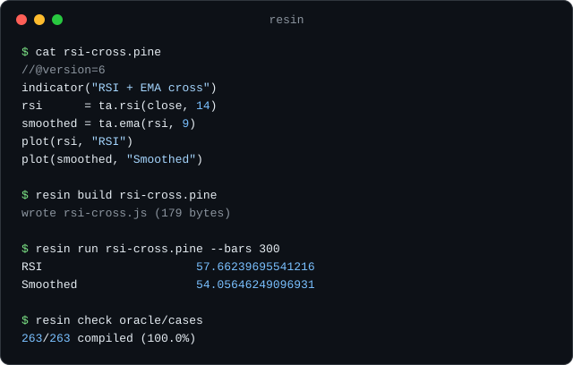

<p align="center">
  
</p>

<h1 align="center">Resin</h1>

<p align="center"><strong>Run TradingView Pine Script outside TradingView.</strong></p>

<p align="center">
  <a href="https://github.com/nullarch/resin/actions/workflows/ci.yml"></a>
  
  
  <a href="LICENSE"></a>
</p>

<p align="center">
  <a href="#quick-start">Quick start</a> ·
  <a href="API.md">Library API</a> ·
  <a href="https://www.wavealgo.com/leaderboard">See it in production: the wavealgo leaderboard ↗</a>
</p>

<p align="center">
  <strong>English</strong> ·
  <a href="README.zh-CN.md">简体中文</a> ·
  <a href="README.ja.md">日本語</a> ·
  <a href="README.ko.md">한국어</a>
</p>

<p align="center">
  
</p>

Resin compiles Pine Script v5/v6 to a plain JavaScript module and runs it —
same indicators, same series semantics, your own machine. TradingView will not
let a script leave the platform; this is how you get it out.

- **Matches TradingView's own exports** in full: 19 strategy scenarios (15,989
  trades and statistics) and 72 indicator scenarios (46,482 values and log
  lines) — [how it is verified](#how-it-is-verified)
- **99.7%** of 2,979 real-world scripts transpile and **99.5%** run
  ([measured, method below](#coverage-and-where-the-numbers-come-from)) — that
  they run, not that their values are right
- **10,305 tests**, plus 5,000 generated scenarios compared bar by bar with a
  reference engine certified against TradingView
- **Zero runtime dependencies** — the CLI runs straight from a clone, no
  install step, no build step
- **Running in production** — every score on the
  [wavealgo leaderboard](https://www.wavealgo.com/leaderboard) is computed by
  this engine

## Quick start

Requires Node 22.18+ (it executes the TypeScript source directly). Nothing to
install:

```bash
git clone https://github.com/nullarch/resin.git
cd resin

# run an indicator and print the last bar's plot values
node bin/resin.mjs run examples/rsi-cross.pine --bars 300
```

```text
RSI                      57.66239695541216
Smoothed                 54.05646249096931
```

```bash
# compile it to a JavaScript module you can read
node bin/resin.mjs build examples/rsi-cross.pine -o rsi-cross.js

# point it at a folder of your scripts and find out how much of it compiles
node bin/resin.mjs check ./my-scripts

# dump everything a chart would need — colors, shapes, drawings — as JSON
node bin/resin.mjs run examples/rsi-cross.pine --bars 300 --viz viz.json

# optional: get `resin` on your PATH instead of typing node bin/resin.mjs
npm install -g @nullarch/resin
```

`run` synthesizes deterministic bars by default; pass `--data bars.json` to use
your own OHLCV data. The same CLI works without the clone: `npx @nullarch/resin build my.pine`.

## Why

Pine is a good language for expressing a trading idea and a bad place to keep
one. You cannot run a Pine script in CI, cannot backtest a thousand of them in
an afternoon, cannot embed one in a bot, and cannot take the indicator you spent
a weekend tuning and put it in your own application. Every one of those needs
the script to run somewhere else.

Resin is a compiler and a runtime, not a charting product. It gives you the
values; what you do with them is yours.

## In production: the wavealgo leaderboard

The clearest demonstration of "run Pine outside TradingView" is a site that
does it at scale. [wavealgo.com/leaderboard](https://www.wavealgo.com/leaderboard)
— built by the same team — grades Pine strategies the way a single chart
never can: each script is compiled by this engine and backtested across
**6 markets × 3 timeframes, 18 cells per script**, with TradingView's
next-bar-open fill rule and per-side fees, then given a verdict and an alpha
score. Every number on that page came out of this compiler; the
[methodology](https://www.wavealgo.com/methodology) is public.

If you want to see what Resin's output looks like before cloning anything,
start there.

## Coverage, and where the numbers come from

**The corpus 0.3.0 is measured on:** 3,904 Pine v5/v6 files collected from 543
public GitHub repositories.

| | scripts | |
|---|---:|---|
| v5/v6 files | 3,904 | |
| — scraped web pages, not source files | −413 | a prose header, code cut off at "Expand" |
| — not valid Pine | −313 | judged by hand, each with the manual's sentence that makes it invalid |
| — import a published library the corpus does not carry | −199 | counted apart: 21 of them transpile |
| **Plain scripts** | **2,979** | |
| **Transpile** | **2,970** | **99.7%** |
| **Run** 1,500 synthetic hourly bars without an error | **2,964** | **99.5%** |

The six that transpile but do not run all halt with a Pine runtime error: five
call `runtime.error()` themselves, most of them to refuse the 60-minute test
chart, and one hands `str.format` a pattern it rejects. This measures that
real scripts get through, not that their values are right; values are what the
[next section](#how-it-is-verified) is about.

**The 0.1 survey, kept as a historical measurement.** Measured for 0.1.0 and
not re-run since, against a larger snapshot of **12,424** public Pine v5/v6
scripts collected from GitHub:

| | scripts | |
|---|---:|---|
| Snapshot | 12,424 | v5/v6, deduplicated |
| — TradingView rejects them too | −1,085 | verified against TradingView's own compiler |
| — import a private library we cannot resolve | −719 | out of scope |
| **Denominator** | **10,618** | |
| **Compiles** | **10,100** | **95.1%** |

The 1,085 exclusions are not our judgment. Every failing script was submitted to
TradingView's own compiler and recorded; those are the ones TradingView also
refuses. An earlier version of this project made that call by inference instead
and came close to discarding about 1,200 perfectly valid scripts.

**Neither corpus is in this repository.** Both are thousands of third-party
scripts under mixed and often absent licenses, and redistributing them is not
ours to do. So you cannot reproduce those specific numbers here — you can only
reproduce the method, by running `resin check` over scripts you already have.

The `corpus/` directory you will find here is a different set again: Pine
fixtures taken from the test suite of the sibling implementation resin was first
built against, replayed against its golden output as a regression check (below).
Source comments that cite `corpus/wild/...` mean the 0.1 survey, and those paths
do not resolve here.

## How it is verified

A compiler that only agrees with itself proves nothing, and this one learned
that the hard way ([below](#how-this-was-built)). Since 0.3.0 a separate
harness measures resin against ground truth, in this order of authority:

1. **TradingView's own results.** PyneSys recorded TradingView exports and
   published them in PyneCore's repository (Apache-2.0): List of Trades exports
   of 19 strategy scenarios — TradingView's built-in strategies, and runs with
   commission, slippage, pyramiding, a futures point value and the bar
   magnifier — and chart exports, Pine Logs output and measured values of 72
   indicator scenarios covering `ta.*`, `math.*`, `str.*`, `timeframe.*`,
   `session.*` and `request.security`. Resin reproduces every one of them in
   full: 15,989 of 15,989 trade and statistic records, fills within half a
   tick, and 46,482 of 46,482 indicator records at the tolerance of PyneCore's
   own tests (log lines exactly). 0.2.2 matched 2 of the 19 strategy scenarios.
2. **A reference engine certified against TradingView, and fuzzing against
   it.** PyneCore, pinned, matches TradingView trade for trade on 380 of 402
   published strategies and bit for bit on 99.64% of 61.8M bars, and passes
   every scenario above. The harness writes each generated scenario twice —
   Pine for resin, Python for PyneCore — and compares every trade and every bar
   at 1e-9. Of 5,000 generated scenarios 4,937 match: all 3,600 strategy
   scenarios, all 600 language scenarios (var/varip, function call sites,
   history, laziness, division, UDTs) and 737 of 800 indicator scenarios; 117
   of 118 hand-written probes pass.
3. **The Pine manual**, where the first two say nothing, and where the
   reference engine contradicts an explicit sentence of it and no TradingView
   measurement decides. Such disagreements are written up and ruled on by a
   person, never by the loop.
4. **A real-world corpus** ([above](#coverage-and-where-the-numbers-come-from)):
   does a script transpile and run. Acceptance only.

Every rule changed for 0.3.0 was found and fixed this way, one per commit, with
its evidence in the commit message; [CHANGELOG.md](CHANGELOG.md) lists them,
and the divergences still open.

Resin's own suite, 10,305 tests, pins those rules down; on its own it is not
evidence. The older differential suite is still in the repository: 263 cases in
`oracle/` and a 3,000-script replay of `corpus/`, compared at 1e-9 against the
sibling implementation's goldens. Where TradingView's evidence contradicted a
golden, the golden was corrected or the mismatch recorded, with the evidence
cited; the suite now guards against regressions and nothing more.

What is **not** verified:

- the values of an arbitrary real script — the corpus checks only that it
  runs; its numbers are as verified as the rules it shares with the scenarios
  above;
- drawings (`label`, `line`, `box`, `table`) and the rest of the `viz` capture;
- v5-only rules — integer division of constants, strict `and`/`or`, na
  booleans, v5 overloads and defaults — against anything but the manual, since
  the reference engine implements v6.

## What works

Pine's semantics are unusual and most of the work is there rather than in the
syntax. Every value is a time series, `var` and `varip` have their own
initialization rules, `na` is not `NaN` in every context, technical-analysis
functions carry hidden per-call state that has to be allocated at compile time,
and a conditionally-executed `ta.*` call still has to advance its state on bars
where the branch is not taken. Those are the parts that are implemented and
tested.

68 `ta.*` functions, with TradingView's `na` handling and, for most, lengths
that change from bar to bar; the strategy engine — entries, exits and brackets,
pyramiding, OCA groups, commission, slippage, margin calls,
`process_orders_on_close`, `calc_on_order_fills`, the bar magnifier and the
`strategy.*` statistics; user-defined types and methods, arrays, maps,
matrices; `request.security` on the chart's symbol or on feeds you supply,
nested requests and expressions evaluated in the requested context included;
`timeframe.*` and `session.*` on the symbol's exchange calendar; drawing
objects; and the `input.*` family.

## Using it as a library

```js
import { transpile, compile, Context } from '@nullarch/resin';

const result = transpile(source, { chartTf: 'D' });
if (!result.ok) throw new Error(result.errors.join('\n'));

const ctx = Context.from(result, data);
const bar = compile(result.code)(ctx);
for (let i = 0; i < ctx.barCount; i++) { ctx.advance(); bar(); }

console.log(ctx.plots[0].toArray());
```

`run(result, data)` does the same thing in one call when you do not need to
observe state as it goes, and its return carries `viz`: plot styles and per-bar
colors, marker conditions, background/bar-color stripes, fills, and every
label/line/box/table the script created. The supported surface is exactly what
`src/index.ts` exports and nothing else — everything under `src/` beyond that
is internal and will change. See [API.md](API.md).

A strategy's numbers depend on the symbol it runs on. Pass the symbol's tick
and lot grid, point value and exchange calendar as
`transpile(source, { chartTf, syminfo })` — the defaults are a 0.01 tick, a lot
of 1, a point value of 1, UTC, and a market open around the clock — and other
symbols' bars (for `request.security`) or lower-timeframe bars (for
`use_bar_magnifier`) as `run(result, data, { security, magnifier })`, or the
same options to `Context.from`.

The package ships TypeScript source. Bundlers (Next.js, Vite, webpack) consume
it as-is; on plain Node, run your script with the bundled loader hook:

```sh
node --import @nullarch/resin/register your-script.mjs
```

## What this does not do

- **No charts.** Resin computes plot series. Drawing them is your problem.
- **Charts are data here, not pixels.** Since 0.2.0 the visualization calls are
  captured instead of dropped: plot styles and per-bar colors, `plotshape` /
  `plotchar` / `plotarrow` / `plotcandle` / `plotbar`, `bgcolor` / `barcolor` /
  `hline` / `fill`, and every `label` / `line` / `box` / `table` creation come
  back under `run(result, data).viz` — or `resin run --viz out.json` from the
  CLI. [resin-lightweight-charts](https://github.com/nullarch/resin-lightweight-charts)
  renders that data on TradingView's own open-source charts; `polyline`,
  `linefill`, `alert` and `alertcondition` remain no-ops.
- **Strategy results are confirmed against TradingView for the scenarios
  above, not for every script.** The broker emulator reproduces TradingView's
  List of Trades on the 19 exported scenarios and the certified engine on 3,600
  generated ones. A script that combines features in a way none of them
  exercises can still meet a rule that has not been measured.
- **Intrabar fills are TradingView's assumption, not the market's path.** OHLC
  does not record where inside a bar a stop, a limit or a trailing exit was
  hit. Resin assumes what TradingView assumes — the open, then the nearer
  extreme, the farther one, the close — or, with `use_bar_magnifier`, walks the
  lower-timeframe bars you hand it. That reproduces TradingView's backtest,
  which is itself an estimate.
- **No realtime.** Resin runs a closed dataset: every bar is historical, the
  last one included, and nothing is recalculated tick by tick.
- **Symbol properties are yours to supply.** Tick size, lot size, point value,
  timezone and session schedule change the results, and Resin cannot look them
  up: pass them in `syminfo`. `hour`, `dayofweek` and the other time builtins
  still read UTC whatever the timezone; only `str.format_time`,
  `timeframe.change` and `session.*` follow it.
- **`request.security` reads the bars you supply**, never fetched ones. On the
  chart's own symbol Resin builds the higher timeframe from the chart's bars;
  another symbol reads the feed you pass in `opts.security`, or the chart's bars
  when there is none. Built from the chart's bars, a higher-timeframe value
  currently arrives one chart bar later than in the reference engine and the
  manual — a known gap; requests fed through `opts.security` pair correctly.
- **No `v4` or earlier.** v5 is the floor.
- **Some semantics are still reasoned, not measured.** Where neither
  TradingView's exports nor the reference engine say anything, Resin follows
  the manual; where even the manual is silent, the reasoning and its evidence
  sit in a comment at the call site, marked as a hypothesis rather than a
  measurement.
- **Known gaps are recorded where they bite.** The long tail is things like a
  `ta.alma` or `ta.cog` length that changes from bar to bar, or
  `request.security` returning an object with an array field. Each is commented
  at the point where it is refused, with a workaround when one exists.

## How this was built

Resin was developed by an autonomous agent loop over 800-odd iterations, each
one a single commit against a fixed set of state files. That loop checked its
work against a sibling implementation of the language, and it converged on that
implementation's mistakes: 9,883 green tests passed while the strategy engine
ignored commission, slippage and `process_orders_on_close`, `ta.rsi` started a
bar early and `ta.supertrend` pointed the wrong way.

0.3.0 is the work of a second loop that does not grade its own homework. The
harness described above measures resin against TradingView's results and the
certified reference engine, ranks the divergences, and shrinks each one to a
minimal repro; one iteration fixes one rule, behind a ratchet that never lets a
number fall. Each of its 121 commits states the rule, quotes its evidence and
lists what moved.

One consequence of the first loop is visible in the source, and you should know
about it before you read anything:

- **All compiler and runtime error messages are English** — the 365 that began
  in Korean were translated first, ahead of everything else on this list,
  because they were the only item that affected *using* the tool rather than
  *reading* it. The full suite, including the 3,000-script differential replay,
  pinned that change to zero behavioral movement.
- **About a quarter of the lines in `src/` are Korean comments**, roughly
  12,400. Skipping them is not really an option — much of the reasoning behind
  an odd-looking branch lives there — so they are being translated rather than
  stripped. Comments added since 0.2.2 are English, apart from edits to
  existing Korean ones.
- Code, identifiers, README and API docs are English throughout.

## Notice on PineTS

[PineTS](https://github.com/alaa-eddine/PineTS) is an existing AGPL-3.0
Pine-to-JavaScript project. Resin shares no code with it. It was consulted as a
black-box behavioural reference for TradingView semantics that are otherwise
undocumented — the value of `dayofweek`, which plot styles exist, that sort of
thing — and every place that happened is cited in a source comment so the
provenance is auditable rather than asserted. Facts about a third-party product
are not copyrightable; its implementation was not read into this one.

## License

Apache-2.0. See [LICENSE](LICENSE).

Pine Script and TradingView are trademarks of TradingView, Inc. This project is
not affiliated with or endorsed by TradingView.
