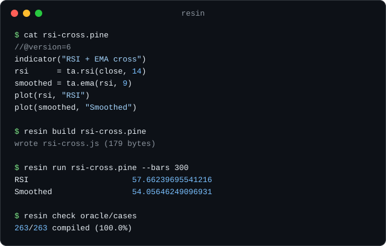

<p align="center">
  
</p>

<h1 align="center">Resin</h1>

<p align="center"><strong>在 TradingView 之外运行 Pine Script。</strong></p>

<p align="center">
  <a href="https://github.com/nullarch/resin/actions/workflows/ci.yml"></a>
  
  
  <a href="LICENSE"></a>
</p>

<p align="center">
  <a href="#quick-start">快速开始</a> ·
  <a href="API.md">库 API</a> ·
  <a href="https://www.wavealgo.com/leaderboard">线上实例：wavealgo 排行榜 ↗</a>
</p>

<p align="center">
  <a href="README.md">English</a> ·
  <strong>简体中文</strong> ·
  <a href="README.ja.md">日本語</a> ·
  <a href="README.ko.md">한국어</a>
</p>

<p align="center">
  
</p>

Resin 把 Pine Script v5/v6 编译成一个普通的 JavaScript 模块并运行它——相同的指标，
相同的序列语义，跑在你自己的机器上。TradingView 不让脚本离开平台；这是把它带出来的方法。

- **与 TradingView 自己的导出结果一致**，覆盖 95 个场景中的 93 个：全部 20 个策略场景
  （16,259 条交易与统计）以及 75 个指标与库场景中的 73 个，均以 PyneCore `0fd57d7` 为基准测得；
  两处未通过的场景和未覆盖的内容都已列出——[如何验证](#how-it-is-verified)
- 2,979 个真实世界脚本中 **99.7%** 可转译、**99.5%** 可运行（[测量方法见下文](#coverage)）
  ——指的是能跑起来，而不是数值正确
- **10,431 项测试**，另有 5,000 个生成场景，逐根 K 线与一个经 TradingView 认证的参考引擎比对
- **零运行时依赖**——CLI 从 clone 出来即可运行，无需安装步骤，无需构建步骤
- **已在生产环境运行**——[wavealgo 排行榜](https://www.wavealgo.com/leaderboard)
  上的每一个分数都由这个引擎计算

<a id="quick-start"></a>

## 快速开始

需要 Node 22.18+（它直接执行 TypeScript 源码）。无需安装任何东西：

```bash
git clone https://github.com/nullarch/resin.git
cd resin

# 运行一个指标，打印最后一根 K 线的 plot 值
node bin/resin.mjs run examples/rsi-cross.pine --bars 300
```

```text
RSI                      57.66239695541216
Smoothed                 54.05646249096931
```

```bash
# 把它编译成一个你能读懂的 JavaScript 模块
node bin/resin.mjs build examples/rsi-cross.pine -o rsi-cross.js

# 指向你自己的脚本目录，看看其中有多少能编译通过
node bin/resin.mjs check ./my-scripts

# 把图表需要的一切——颜色、形状、绘图对象——导出为 JSON
node bin/resin.mjs run examples/rsi-cross.pine --bars 300 --viz viz.json

# 可选：把 `resin` 装到 PATH 上，省去每次输入 node bin/resin.mjs
npm install -g @nullarch/resin
```

`run` 默认合成确定性的 K 线数据；传入 `--data bars.json` 即可使用你自己的 OHLCV 数据。
不 clone 也能使用同一个 CLI：`npx @nullarch/resin build my.pine`。

## 为什么

Pine 是表达交易想法的好语言，却是保存交易想法的糟糕地方。你没法在 CI 里跑一个 Pine 脚本，
没法用一个下午回测一千个脚本，没法把某个脚本嵌进机器人里，也没法把你花了一个周末调参的指标
放进自己的应用。上面每一件事，都要求脚本能在别处运行。

Resin 是编译器和运行时，不是图表产品。它给你数值；拿这些数值做什么，是你的事。

## 生产环境：wavealgo 排行榜

要证明"在 TradingView 之外运行 Pine"，最直接的方式就是一个大规模这么做的网站。
[wavealgo.com/leaderboard](https://www.wavealgo.com/leaderboard)——由同一团队构建——
以单张图表永远做不到的方式给 Pine 策略打分：每个脚本都由这个引擎编译，并在
**6 个市场 × 3 个周期，即每个脚本 18 个单元格**上回测，采用 TradingView 的
"下一根 K 线开盘价成交"规则并计入双边手续费，最后给出结论和 alpha 分数。
那个页面上的每一个数字都出自这个编译器；[方法论](https://www.wavealgo.com/methodology)是公开的。

如果你想在 clone 任何东西之前先看看 Resin 的输出长什么样，从那里开始。

<a id="coverage"></a>

## 覆盖率，以及这些数字从何而来

**0.3.0 所测量的语料库：** 从 543 个公开 GitHub 仓库收集的 3,904 个 Pine v5/v6 文件。

| | 脚本数 | |
|---|---:|---|
| v5/v6 文件 | 3,904 | |
| — 抓取来的网页，而非源文件 | −413 | 带说明性文字的页头，代码在 "Expand" 处被截断 |
| — 不是合法的 Pine | −313 | 人工判定，每一个都附有使其不合法的手册原文 |
| — 引用了语料库中没有的已发布库 | −199 | 单独统计：其中 21 个可转译 |
| **普通脚本** | **2,979** | |
| **可转译** | **2,970** | **99.7%** |
| **在 1,500 根合成的 1 小时 K 线上无错误运行** | **2,964** | **99.5%** |

能转译却无法运行的 6 个脚本，全都因 Pine 运行时错误而停止：其中 5 个自己调用了 `runtime.error()`
——大多是为了拒绝 60 分钟的测试图表——另外 1 个给 `str.format` 传入了它不接受的模式。这个数字
衡量的是真实脚本能否跑通，而不是它们的数值是否正确；数值是[下一节](#how-it-is-verified)的主题。

**0.1 的普查——作为历史测量保留。** 这是 0.1.0 时测得、此后未再重跑的数字，针对的是一个更大的快照：
从 GitHub 收集的 **12,424** 个公开 Pine v5/v6 脚本：

| | 脚本数 | |
|---|---:|---|
| 快照 | 12,424 | v5/v6，已去重 |
| — TradingView 自己也拒绝的 | −1,085 | 已用 TradingView 自家编译器逐个核实 |
| — 引用了我们无法解析的私有库 | −719 | 超出范围 |
| **分母** | **10,618** | |
| **可编译** | **10,100** | **95.1%** |

那 1,085 个排除项不是我们的判断。每一个编译失败的脚本都被提交给 TradingView 自家的编译器
并记录了结果；这些是 TradingView 同样拒绝的脚本。本项目更早的版本曾用推断代替核实，
差点因此丢掉约 1,200 个完全有效的脚本。

**这两个语料库都不在本仓库中。** 它们都是数千个第三方脚本，许可证混杂且往往缺失，重新分发不是
我们能做的事。所以你无法在这里复现那些具体数字——你只能复现方法：对你手上已有的脚本运行
`resin check`。

你在仓库里看到的 `corpus/` 目录又是另一批东西：它是取自 Resin 最初据以对照的那个姊妹实现的测试
套件中的 Pine 用例，作为回归检查与该实现的黄金输出对照（见下文）。源码注释中引用的
`corpus/wild/...` 指的是 0.1 的普查，那些路径在这里无法解析。

<a id="how-it-is-verified"></a>

## 如何验证

一个只和自己一致的编译器什么也证明不了，这个项目是吃过亏才学到这一点的（[见下文](#how-this-was-built)）。
从 0.3.0 起，由一个独立的测试框架（harness）拿 Resin 与标准答案对照，权威顺序如下：

1. **TradingView 自己的结果。** PyneSys 记录了 TradingView 的导出结果，并发布在 PyneCore 的仓库中
   （Apache-2.0）。我们以 PyneCore 的 `0fd57d7` 提交（2026-11-09）为基准进行测量。PyneCore 自己的
   脚本是 Python，所以每个场景对应的 Pine 都是我们根据它们重建的，并不是 PyneSys 的 Pine。该仓库中的
   97 个场景里，95 个是 TradingView 导出，2 个是手工构造的测试夹具（`sess_002`、`draw_001`）；
   Resin 在这 97 个中完整匹配 95 个，在 95 个导出中完整匹配 93 个：
   - **策略，20 个场景。** 14 个 List of Trades 导出——TradingView 内置策略，以及启用了手续费、
     滑点、加仓、期货点值、K 线放大器（bar magnifier）和逐步推进的 `calc_on_order_fills` 的运行
     （15,139 笔已平仓交易，每笔都按方向、入场和出场 K 线匹配，价格在半个最小跳动单位以内，
     数量的相对误差在 1e-6 以内，且没有多出的交易）——外加来自 3 个图表导出的 6 个场景，
     这些导出记录的是绘制出来的 `strategy.*` 值（1,120 根 K 线，每根上的每个绘制值都已匹配）。
   - **指标与库，77 个场景**（`ta.*`、`math.*`、`str.*`、`timeframe.*`、`session.*`、
     `request.security`、`map.*`、`array.*`、`matrix.*`、`time`/`timestamp`、`chart.point`）：
     图表导出和 Pine Logs 输出。序列以 1e-6 的精度匹配（PyneCore 自己的容差更宽松，相对 1e-5、
     绝对 1e-8，且不会改变任何结论），`na` 只与 `na` 匹配，日志行在去除首尾空白后必须逐字一致。
     其中 75 个匹配；未匹配的两个是 `array.slice`（见下）。
   - **未匹配。** `array_002` 和 `array_003`：TradingView 的 `array.slice` 是一个会写穿到源数组的
     视图，而 Resin 的是副本，因此每一条依赖这次写入的输出行都不同。
   - **目前还不是面向用户的功能。** 日志行结果是通过 `onLog` 选项捕获的；在它出现之前，测试框架
     只能替换内部函数才能看到这些结果。
   - **尚未发布。** 产出这些数字的测试框架——用例清单、Pine 文件、计数规则——不在本仓库中。
     在它发布之前，这些数字只能通过重复同样的方法来核查。
   0.2.2 在当时存在的 19 个策略场景中只有 2 个完全一致。
2. **一个经 TradingView 认证的参考引擎，以及针对它的模糊测试。** PyneSys 报告称，PyneCore 在 402 个
   已发布策略中的 380 个上与 TradingView 逐笔交易一致，在 61.8M 根 K 线中的 99.64% 上逐位一致
   （这是他们的数字，此处未重新测量；PyneCore 的测试套件包含上面的场景）。测试框架把每个生成的场景写成两份——给 Resin 的 Pine，给 PyneCore 的
   Python——然后以 1e-9 的精度比对每一笔交易和每一根 K 线。5,000 个生成场景中有 4,937 个一致：
   全部 3,600 个策略场景、全部 600 个语言场景（var/varip、函数调用点、历史值、惰性求值、除法、
   UDT），以及 800 个指标场景中的 737 个；手写的探针用例 118 个中通过 117 个。
3. **Pine 手册**：用于前两者都没有说法的地方，以及参考引擎与手册中某句明确表述相矛盾、而又没有
   TradingView 实测可以裁决的地方。这类分歧会被整理成文，由人来裁定，绝不由循环自行决定。
4. **一个真实世界语料库**（[见上文](#coverage)）：脚本能否转译、能否运行。只检验能否接受。

0.3.0 中改动的每一条规则都是这样发现并修复的，一次提交一条规则，证据写在提交信息里；
[CHANGELOG.md](CHANGELOG.md) 列出了它们，以及仍未解决的分歧。

Resin 自己的测试套件（10,431 项测试）把这些规则固定下来；单凭它本身并不构成证据。旧的差分套件仍在
仓库里：`oracle/` 中的 263 个用例和对 `corpus/` 的 3,000 个脚本回放，以 1e-9 的精度与姊妹实现的黄金
输出比对。凡是 TradingView 的证据与黄金输出相矛盾的地方，要么修正了黄金输出，要么记录了这处不一致，
并注明证据；这个套件如今只用于防止回归。

**未经**验证的内容：

- 任意真实脚本的数值——语料库只检查它能否运行；它的数字只在它与上述场景共享的规则范围内得到验证；
- 绘图对象（`label`、`line`、`box`、`table`）以及其余的 `viz` 捕获；
- 作为视图的 `array.slice`：Resin 返回的是副本，因此对切片的写入不会传到源数组；
- 上述 97 个场景之外的一切，包括带时区的 `time`/`timestamp` 以及非 UTC 的交易所——没有任何导出覆盖它；
- 仅属于 v5 的规则——常量之间的整数除法、严格求值的 `and`/`or`、na 布尔值、v5 的重载与默认值——
  只与手册对照过，因为参考引擎实现的是 v6。

## 已实现的部分

Pine 的语义很不寻常，大部分工作量在语义而非语法上。每个值都是时间序列；`var` 和 `varip`
各有自己的初始化规则；`na` 并不在所有上下文中都等同于 `NaN`；技术分析函数携带隐藏的、
按调用点区分的状态，必须在编译期分配；而一个位于条件分支中的 `ta.*` 调用，即使分支未被执行，
它的状态在那根 K 线上仍然必须推进。这些正是已实现并经过测试的部分。

68 个 `ta.*` 函数——采用 TradingView 的 `na` 处理方式，其中大多数支持逐根 K 线变化的长度；策略
引擎——入场、出场与括号单、加仓、OCA 组、手续费、滑点、追加保证金强平、`process_orders_on_close`、
`calc_on_order_fills`、K 线放大器以及 `strategy.*` 统计；用户自定义类型与方法、数组、映射、矩阵；
作用于图表品种或你提供的数据源的 `request.security`，包括嵌套请求和在被请求上下文中求值的表达式；
在品种的交易所日历上计算的 `timeframe.*` 与 `session.*`；绘图对象；以及 `input.*` 家族。

## 作为库使用

```js
import { transpile, compile, Context } from '@nullarch/resin';

const result = transpile(source, { chartTf: 'D' });
if (!result.ok) throw new Error(result.errors.join('\n'));

const ctx = Context.from(result, data);
const bar = compile(result.code)(ctx);
for (let i = 0; i < ctx.barCount; i++) { ctx.advance(); bar(); }

console.log(ctx.plots[0].toArray());
```

当你不需要在执行过程中观察状态时，`run(result, data)` 用一次调用完成同样的事情，而且它的
返回值带着 `viz`：plot 的样式与逐 K 线颜色、标记的条件、背景/K 线颜色条带、fill，以及脚本
创建的每一个 label/line/box/table。受支持的接口面恰好就是 `src/index.ts` 导出的内容，
仅此而已——`src/` 下的其余一切都是内部实现，会发生变化。详见 [API.md](API.md)。

策略的数字取决于它运行在哪个品种上。请把品种的最小价格变动与最小交易单位、点值和交易所日历通过
`transpile(source, { chartTf, syminfo })` 传入——默认值是最小变动 0.01、交易单位 1、点值 1、UTC，
以及全天候开市的市场。其他品种的 K 线（供 `request.security` 使用）或更低周期的 K 线（供
`use_bar_magnifier` 使用）通过 `run(result, data, { security, magnifier })` 传入，或把同样的选项
传给 `Context.from`。

包直接分发 TypeScript 源码。打包器（Next.js、Vite、webpack）可以原样消费；在纯 Node
环境下，请带上随包附带的加载器钩子运行你的脚本：

```sh
node --import @nullarch/resin/register your-script.mjs
```

## 不做的事

- **没有图表。** Resin 计算 plot 序列。把它们画出来是你的事。
- **在这里，图表是数据而不是像素。** 从 0.2.0 起，可视化调用不再被丢弃，而是被捕获：
  plot 的样式与逐 K 线颜色、`plotshape` / `plotchar` / `plotarrow` / `plotcandle` /
  `plotbar`、`bgcolor` / `barcolor` / `hline` / `fill`，以及每一次 `label` / `line` /
  `box` / `table` 的创建，都会通过 `run(result, data).viz` 返回——CLI 里用
  `resin run --viz out.json`。[resin-lightweight-charts](https://github.com/nullarch/resin-lightweight-charts)
  可以把这些数据画在 TradingView 自家的开源图表上；`polyline`、`linefill`、
  `alert` 和 `alertcondition` 仍是空操作。
- **策略结果针对上述场景与 TradingView 对照确认过，但并非针对所有脚本。** 经纪商模拟器在 14 个
  导出场景上复现了 TradingView 的 List of Trades，在 3,600 个生成场景上复现了经认证的引擎。一个以
  这些场景都没有覆盖的方式组合功能的脚本，仍可能碰到尚未测量过的规则。
- **K 线内成交是 TradingView 的假设，而不是市场的真实路径。** OHLC 并不记录止损单、限价单或追踪止损
  在 K 线内部的哪个位置被触发。Resin 采用与 TradingView 相同的假设——开盘价，然后是较近的极值、
  较远的极值、收盘价——或者在启用 `use_bar_magnifier` 时，沿着你提供的更低周期 K 线逐根走。这样
  复现的是 TradingView 的回测，而那本身也是一种估计。
- **没有实时。** Resin 运行的是封闭的数据集：包括最后一根在内，每根 K 线都是历史 K 线，没有任何东西
  会逐笔重新计算。
- **品种属性需要你自己提供。** 最小变动价位、交易单位、点值、时区和交易时段安排都会改变结果，而
  Resin 无法去查询它们：请通过 `syminfo` 传入。`hour`、`dayofweek` 等时间内置函数不论时区如何，
  目前仍读取 UTC；只有 `str.format_time`、`timeframe.change` 和 `session.*` 遵循时区。
- **`request.security` 读取的是你提供的 K 线**，而非拉取而来。对图表自身的品种，Resin 用图表的 K 线
  构建高周期；其他品种读取你通过 `opts.security` 传入的数据源，没有数据源时读取图表的 K 线。由图表
  K 线构建的高周期数值，目前比参考引擎和手册晚一根图表 K 线到达——这是一个已知缺口；通过
  `opts.security` 提供数据源的请求则能正确对齐。
- **不支持 `v4` 及更早版本。** v5 是下限。
- **部分语义仍是推理出来的，而非实测的。** 在 TradingView 的导出结果和参考引擎都没有说法的地方，
  Resin 遵循手册；在连手册都没有提及的地方，推理过程及其依据写在调用点的注释里，并明确标注为假设
  而非实测。
- **已知缺口记录在它们真正碍事的地方。** 长尾问题包括：逐根 K 线变化的 `ta.alma`、`ta.cog` 长度，
  或者返回带数组字段的对象的 `request.security`。每一处都在被拒绝的位置写了注释，有可行绕法时也会
  一并给出。

<a id="how-this-was-built"></a>

## 这是怎么造出来的

Resin 由一个自主 agent 循环开发，历经 800 多次迭代，每次迭代都是针对一组固定状态文件的单次提交。
那个循环拿一个同语言的姊妹实现来检验自己的工作，结果收敛到了那个实现的错误上：策略引擎忽略手续费、
滑点和 `process_orders_on_close`，`ta.rsi` 早一根 K 线开始，`ta.supertrend` 指向反了——而这期间
9,883 项测试始终全绿。

0.3.0 是第二个循环的成果，这个循环不给自己的作业打分。上文所述的测试框架拿 Resin 与 TradingView 的
结果和经认证的参考引擎对照，给分歧排序，并把每一处缩减成最小复现用例；每次迭代修复一条规则，并处在
一个不允许任何数字下降的棘轮之后。它的 121 次提交中，每一次都写明规则、引用证据，并列出哪些数字变了。

第一个循环留下的一个后果会留在源码里，在你开始阅读之前就该知道：

- **所有编译器与运行时错误信息都是英文**——最初是韩语的那 365 条先于本清单上的其他一切被翻译，
  因为只有它影响的是*使用*这个工具，而不是*阅读*它。包含 3,000 个脚本差分回放在内的整个测试套件，
  把这次变更钉在了行为零变化上。
- **`src/` 中约四分之一的行是韩语注释**，大约 12,400 行。跳过它们并不现实——很多看起来奇怪的分支
  背后的推理就写在那里——所以它们正在被翻译，而不是被删掉。0.2.2 之后新增的注释，除了对原有韩语
  注释的修改之外，都是英文。
- 代码、标识符、README 与 API 文档全部是英文。

## 关于 PineTS 的声明

[PineTS](https://github.com/alaa-eddine/PineTS) 是一个已有的 AGPL-3.0 许可的 Pine 转 JavaScript
项目。Resin 与它没有任何代码共享。它被当作黑盒行为参照，用来观察那些本无文档可查的 TradingView
语义——`dayofweek` 的取值、存在哪些 plot 样式，诸如此类——并且每一处这样做的地方都在源码注释中
注明出处，让来源可被审计而不只是被口头声称。关于第三方产品的事实不受版权保护；它的实现代码
并未被读进这个项目。

## 许可证

Apache-2.0。见 [LICENSE](LICENSE)。

Pine Script 和 TradingView 是 TradingView, Inc. 的商标。本项目与 TradingView 无隶属关系，
亦未获其背书。
